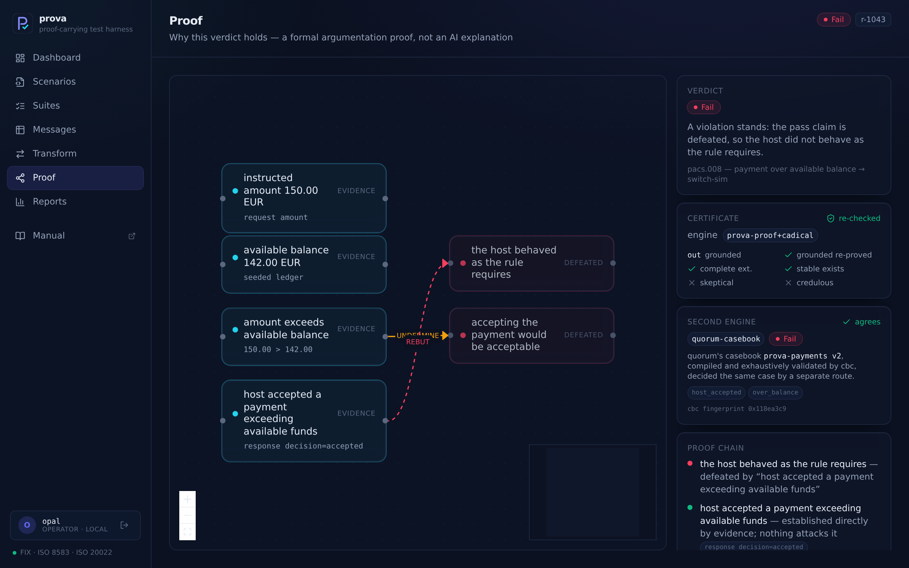
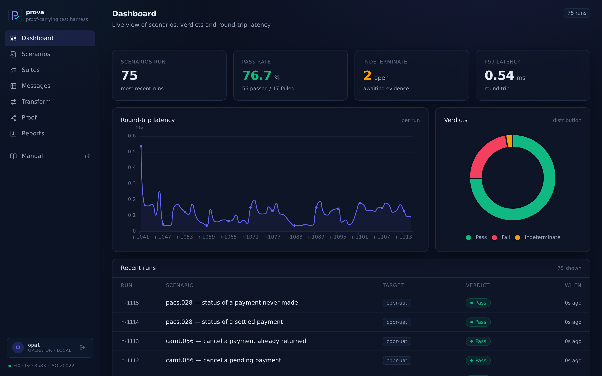
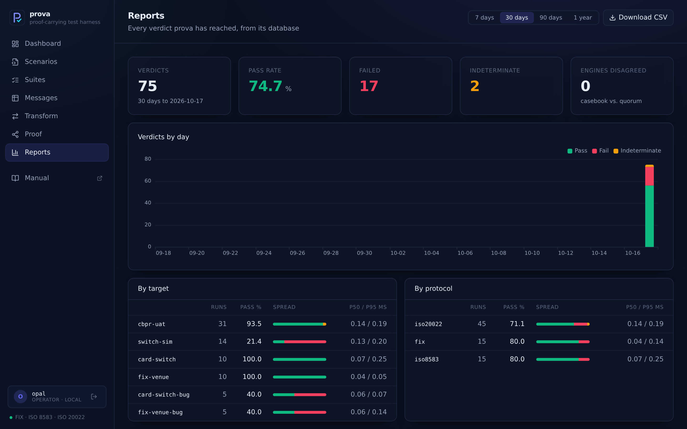
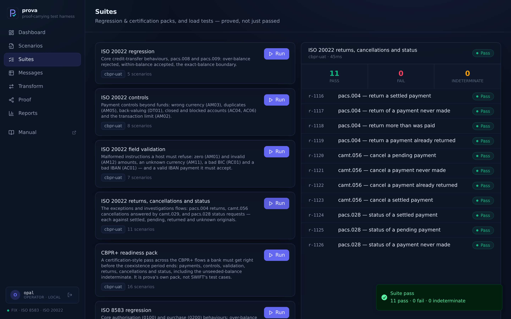
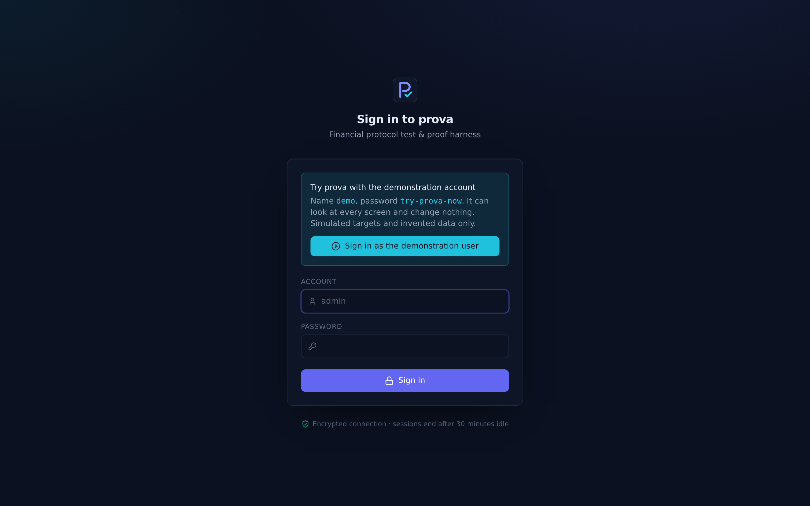
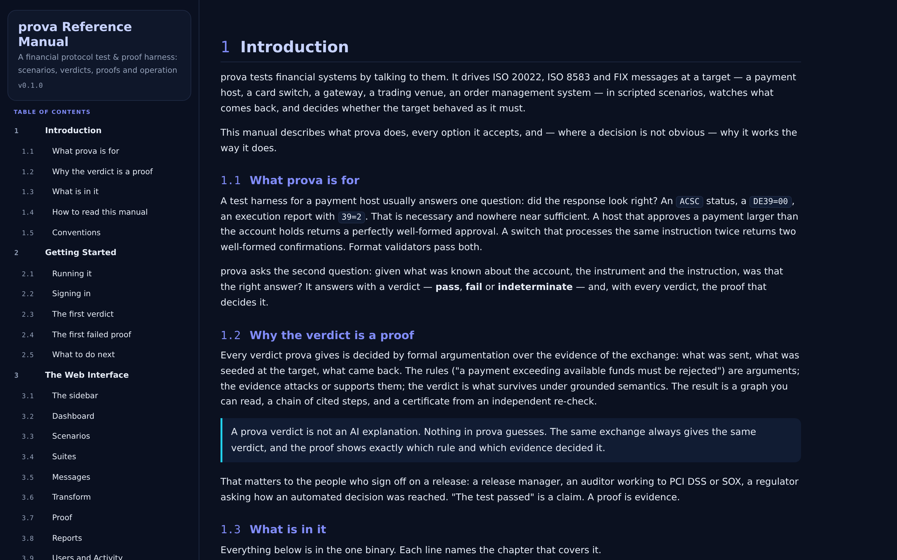

<div align="center">


<h1></h1>

### A financial protocol test harness whose every verdict is a proof

**prova drives ISO 20022, ISO 8583 and FIX at a payment host, card switch or trading venue, and proves whether it
behaved as it must.** A well-formed approval of a payment the account cannot cover is still a defect. prova finds it,
names the rule it breaks and cites the evidence, and an independent SAT-backed check and a second rules engine
confirm the verdict. It is not an AI explanation; nothing in prova guesses.

**One 23 MB program. 25 MB of memory at rest.** The web console, the reference manual, the database, 66
scenarios and six simulated targets are built in. Copy it, run it, open the browser.

[](LICENSE.md) [](https://go.dev) [](#build) [](#build) [](#everything-it-does)

<a href="https://prova.perfuse.health:9443"></a>

<sub><b>Sign in as</b> <code>demo</code> <b>with password</b> <code>try-prova-now</code> · simulated targets only · look at everything, change nothing</sub>

<a href="https://prova.perfuse.health:9443/manual"></a>&nbsp;<a href="#build"></a>

<sub><b>Download v0.1.0</b> for [Linux](https://github.com/BioDream-LLC/prova/releases/download/v0.1.0/prova_v0.1.0_linux_amd64.tar.gz) · [macOS, Apple Silicon](https://github.com/BioDream-LLC/prova/releases/download/v0.1.0/prova_v0.1.0_darwin_arm64.tar.gz) · [Windows](https://github.com/BioDream-LLC/prova/releases/download/v0.1.0/prova_v0.1.0_windows_amd64.tar.gz) — one file, nothing to install</sub>

[**Why prova**](#why-prova) · [**What it does**](#everything-it-does) · [**What it looks like**](#what-it-looks-like) ·
[**Running it**](#running-it) · [**How it compares**](#how-it-compares) · [**Security**](#security) · [**FAQ**](#faq)

</div>

---

## What is prova?

**prova is a test and proof harness for the systems that move money.** It sends real wire messages — a pacs.008
credit transfer, an ISO 8583 0100 authorisation, a FIX NewOrderSingle — to the system under test, reads what comes
back, and decides whether that answer was right given what was known: the balance, the account's currency, the
instruction already processed, the value date.

**The verdict is pass, fail or indeterminate, and it comes with its proof.** Each verdict is decided by formal
argumentation over the evidence of the exchange under grounded semantics. The Proof screen shows the argument graph,
the cited chain of steps, a certificate from an independent re-check (C++ and CaDiCaL), and the verdict of a second,
separately written rules engine. When the evidence does not decide it, prova says so and names what would.

**It is built for the people who sign off.** A release manager who needs more than "the tests passed", an auditor
working to PCI DSS or SOX, a migration lead moving from SWIFT MT to ISO 20022 before the CBPR+ coexistence period
ends: each gets a record of every verdict, who ran it, and why it holds, kept in prova's database and exportable as
CSV.

## Why prova

Every payment and trading system is tested with simulators and format validators. They answer one question — did the
response look right? — and miss the defects that matter:

- a host that **approves a payment larger than the balance** returns a perfectly valid `ACSC`;
- a switch that **processes the same instruction twice** returns two valid confirmations;
- a venue that **fills an order over buying power** returns a valid ExecutionReport.

prova asks the second question: *was that the right answer?* It ships simulated targets with exactly these planted
defects, so the first ten minutes show prova catching them.

## Everything it does

**Protocols**
- **ISO 20022** — pacs.008 and pacs.009 credit transfers, pacs.004 returns, camt.056 cancellations (answered by camt.029) and pacs.028 status requests, with pacs.002 status reports, over a length-prefixed session; IBAN or proprietary accounts; the ISO external reason codes (AM01–AM12, AC01, AC04, AC06, RC01, DT01, NOOR, ARDT …).
- **ISO 8583** — 0100 authorisations, 0200 purchases, 0400 reversals and 0800 network management, with a real bitmap packager including the secondary bitmap; DE39 response codes.
- **FIX 4.4** — tag=value codec with BodyLength and CheckSum, the session layer (Logon, Heartbeat, TestRequest, sequence numbers), NewOrderSingle, OrderCancelRequest, OrderCancelReplaceRequest and OrderStatusRequest, answered by ExecutionReport and OrderCancelReject.
- **MT103 ↔ pacs.008** transformation for the ISO 20022 migration — convert, drive the converted message, prove the result.

**Verdicts**
- A **casebook** of sixteen protocol-agnostic controls: structural and field validity (ISO 4217 currencies and decimals, BIC format, IBAN and Luhn check digits), funds, currency, value date, duplicates, account and card state, transaction limits, references to originals, cancellation state, status reports, market hours, listed instruments, positions and the prescribed reason code.
- **Grounded argumentation semantics**: every verdict is a graph you can read and a cited chain of steps.
- A **second engine**: the same controls written in quorum's casebook language and compiled by its `cbc` compiler, which checks all 8,388,608 combinations of its 23 readings before emitting anything. The two engines agree on all 114,048 generated test cases and on every shipped scenario.
- A **certificate** for every verdict from the C++ `prova-proof` companion (SAT-backed with CaDiCaL), or the in-process checker.
- **Indeterminate** is an answer, with the evidence that would settle it.

**Testing**
- Scenarios in **JavaScript or Lua**, sandboxed, with standards-valid synthetic data (Luhn PANs, IBANs, BICs) and reproducible seeds.
- **66 scenarios** (33 ISO 20022, 17 ISO 8583, 16 FIX) and **eleven suites**: regression, controls and field validation; returns, cancellations and status; card controls; reversals and network; order controls and the order lifecycle; and a CBPR+ readiness pack.
- **Load tests** with throughput and p50/p95/p99 — and every request still judged.
- **Record and replay**: capture traffic as a cassette, re-prove it offline after the rules change.
- **CI**: `prova run` writes JUnit and JSON and fails the build on a failed proof.

**Operation**
- An **embedded SQLite database** of every run with its full proof, suite and load history, and an activity log — no database server.
- **Reports**: pass rate by day, target, protocol, scenario and person; suite and load history; engine disagreements; **CSV export** of every verdict.
- **Sign-in** with local accounts, **OpenID Connect** (Entra ID, Okta, Google, Keycloak) or **SAML 2.0**; roles viewer, operator, admin; sessions that survive a restart.
- **HTTPS only**, HSTS, same-origin writes, PBKDF2 password hashes, session tokens never stored.
- The **reference manual** is served by the binary at `/manual`, with reference chapters generated from the code itself.

## What it looks like

<table>
<tr>
<td width="50%"><br><sub><b>The proof.</b> A host accepted €150.00 against €142.00. The graph, the certificate and the second engine all say why that fails.</sub></td>
<td width="50%"><br><sub><b>The dashboard.</b> Verdicts, latency and the most recent runs, each one a click from its proof.</sub></td>
</tr>
<tr>
<td width="50%"><br><sub><b>Reports.</b> Every verdict from the database, by day, target, protocol, scenario and person, with CSV export.</sub></td>
<td width="50%"><br><sub><b>Suites.</b> Eleven packs across the three protocols, and load tests, each scenario linked to its proof.</sub></td>
</tr>
<tr>
<td width="50%"><br><sub><b>Sign-in.</b> Local accounts, OpenID Connect and SAML; here, the public demonstration's account.</sub></td>
<td width="50%"><br><sub><b>The manual.</b> Served by the binary, numbered, printable to PDF, with reference chapters generated from the code.</sub></td>
</tr>
</table>

## Running it

```
./prova
```

That serves `https://localhost:8443`. The first start prints the `admin` password once, and runs twenty scenarios at
the built-in simulators so every screen has real verdicts on it. Then:

```
prova user add alice operator                       # a colleague; prints her password once
prova -tls-cert cert.pem -tls-key key.pem           # a real certificate for a shared server
prova -public-url https://prova.example.com:8443 \
      -oidc-issuer https://login.microsoftonline.com/TENANT/v2.0 -oidc-client-id ID \
      -oidc-client-secret-file /etc/prova/oidc-secret          # single sign-on (or -saml-idp-metadata URL)
```

In CI:

```
prova run --suite regression-iso20022 --junit results.xml
prova run --scenario fix-over-limit --target fix-venue-bug     # exits 1: defect caught
prova run --suite controls-iso20022 --record cassette.jsonl
prova run --replay cassette.jsonl                              # re-prove offline
```

Everything else — every option, every API endpoint, every shipped scenario and suite — is in the
[manual](https://prova.perfuse.health:9443/manual), which every running prova also serves at `/manual`.

## Try it

A public demonstration runs at **https://prova.perfuse.health:9443** against prova's simulated targets only: sign in as
`demo` with `try-prova-now` (a viewer: it can look at everything and change nothing). A shipped scenario runs every
fifteen minutes, so the dashboard and reports stay current. Open a failed run and read its proof; compare the
second engine's verdict; download the CSV. How it is run is in [`deploy/demo/`](deploy/demo).

## How it compares

The established tools — jPOS and its client simulator, Paragon FASTest, Greenline VeriFIX, FIXSIM, X9Ware, Trace
Financial, AskISO — between them cover thirteen kinds of capability. prova has something in each, and adds the one
none of them has: a verdict that is a machine-checked proof. **Breadth is a different matter, and is stated plainly
here.**

| Capability | prova today | Where the established tools go further |
|---|---|---|
| Simulated counterparties | an ISO 20022 host, ISO 8583 switch and FIX venue, each compliant and defective | scheme-specific hosts and dialects |
| Message coverage | 5 ISO 20022 messages, 4 ISO 8583 MTIs, 4 FIX request types | hundreds of MX messages; Visa, Mastercard and other ISO 8583 dialects; FIX 4.2 and 5.0 SP2 |
| Field validation | ISO 4217, decimals, BIC, IBAN and Luhn checks | full XSD and market usage-guideline validation (CBPR+, SEPA, FedNow) |
| Scenario library | 66 scenarios, 11 suites | libraries of hundreds to thousands of cases |
| Certification packs | prova's own CBPR+ readiness pack | official card-scheme certification test cases |
| Card security | — | PIN, MAC, EMV chip data and HSM integration |
| Load testing | throughput and percentiles, every request judged | larger-scale replay of production traffic |
| Negative testing | controls that prove a *rejection* was right, with the right reason | |
| CI/CD | `prova run`, JUnit and JSON, non-zero exit on failure | |
| Synthetic data | Luhn PANs, IBANs, BICs, amounts, ids; seeded and reproducible | |
| Auditable evidence | every verdict a cited proof with a certificate, stored and exportable | |
| MT ↔ MX | MT103 ↔ pacs.008, then drive and prove the migrated message | more MT and MX message pairs |
| FIX session testing | Logon, heartbeats, TestRequest, sequence numbers, BodyLength and CheckSum | resend and gap-fill recovery |
| Capture and replay | JSONL cassettes, re-proved offline | |

The right-hand column is drawn from the vendors' public material and is the roadmap; see
[docs/comparison.md](docs/comparison.md).

## Security

HTTPS only (TLS 1.2+, HSTS). Every API call needs a session; writes need the operator role and must be JSON from
prova's own origin. Passwords are generated, shown once and stored as PBKDF2-SHA256 hashes; session tokens are never
stored, only their hashes; the database is readable by its owner only. Scenario scripts run sandboxed with no file,
network or process access. prova sends nothing anywhere but to the targets you point it at and your identity
provider. The [Security chapter](https://prova.perfuse.health:9443/manual) of the manual has the detail.

**Report a vulnerability** privately through this repository's Security tab ("Report a vulnerability"), not in a
public issue.

## Build

Go 1.26 or newer; Node 20 and pnpm only to rebuild the interface, which is committed prebuilt.

```
make build        # bin/prova
make test         # go test ./...
make web          # rebuild the interface into internal/web/dist
make proof        # the C++ prova-proof companion (with CaDiCaL if ~/cadical is built)
make manual       # docs/manual/prova-manual.html and .pdf
make release      # per-platform archives in dist/release
```

The layout is described in [docs/architecture.md](docs/architecture.md).

## FAQ

<details>
<summary><b>Is the verdict produced by an AI model?</b></summary>

No. Verdicts come from explicit rules applied to the evidence under grounded argumentation semantics. The same
exchange always gives the same verdict, and the proof shows which rule and which evidence decided it.
</details>

<details>
<summary><b>What does "indeterminate" mean?</b></summary>

That the evidence does not decide it — for example, a host accepted a payment over the balance and the scenario says
an overdraft might cover it. prova names the evidence that would settle it rather than guessing.
</details>

<details>
<summary><b>Do I need the C++ companion?</b></summary>

No. Without `prova-proof`, prova performs the same checks in-process and says so on every certificate. With it, the
re-check is done by a separate program with a SAT solver, which is the stronger statement to give an auditor.
</details>

<details>
<summary><b>Can it test my real host?</b></summary>

Yes: point a scenario or a suite at your target's address. The simulated targets exist so that prova is useful the
moment it starts and so you can see it catch a defect you know is there.
</details>

<details>
<summary><b>Where is my data kept?</b></summary>

In one SQLite file, `prova.db`, in the data directory (`-data`). Back it up by copying it while prova is stopped.
</details>

## Contributions are not accepted

prova is developed and maintained by BioDream LLC. **Pull requests will not be reviewed or merged.** A verdict is only
worth what its rules are worth, and keeping every rule proved, tested on every combination and cited is a discipline
easier to keep in one place.

**Bug reports are wanted.** [Open an issue](https://github.com/BioDream-LLC/prova/issues) with the output of
`prova -version` and, where a message is involved, a synthetic one. Never post real card numbers, account numbers or
customer data.

## Licence

[PolyForm Small Business License 1.0.0](LICENSE.md). Copyright 2026 BioDream LLC. See [NOTICE](NOTICE).

A company with fewer than 100 people and less than USD 1 million in annual revenue may use prova freely. Larger
companies need a commercial licence from BioDream LLC.

prova includes code from Perfuse, a separate BioDream project under the Apache License 2.0, whose licence and notice
are in [licenses/](licenses). ISO 20022, ISO 8583, FIX and SWIFT are named only to say what prova reads and writes;
prova is not affiliated with or endorsed by ISO, the FIX Trading Community, SWIFT or any vendor named here.

<div align="center">

<details>
<summary><b>Keywords</b></summary>

<sub><b>Payments:</b> ISO 20022 testing · pacs.008 · pacs.009 · pacs.004 · camt.056 · camt.029 · pacs.028 · pacs.002 · IBAN validation · CBPR+ · SWIFT MX · MT103 to pacs.008 · MT to MX migration · payment host testing · payment simulator · reason codes AM04 AM05 DT01</sub><br><br>
<sub><b>Cards:</b> ISO 8583 testing · card switch simulator · authorisation testing · 0100 0200 0400 0800 · reversals · DE39 · issuer host testing</sub><br><br>
<sub><b>Trading:</b> FIX protocol testing · FIX 4.4 · FIX simulator · FIX session testing · NewOrderSingle · OrderCancelRequest · OrderCancelReplaceRequest · ExecutionReport · OMS EMS testing</sub><br><br>
<sub><b>Proof:</b> formal verification · argumentation · grounded semantics · SAT solver · CaDiCaL · explainable verdicts · audit evidence · PCI DSS · SOX · regression testing · load testing · single binary · Go · OpenID Connect · SAML</sub>
</details>

</div>
